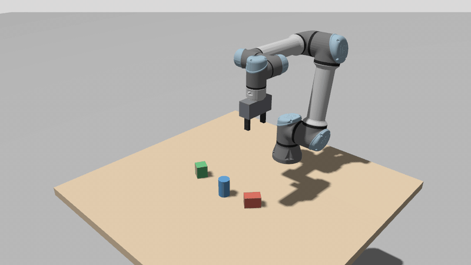
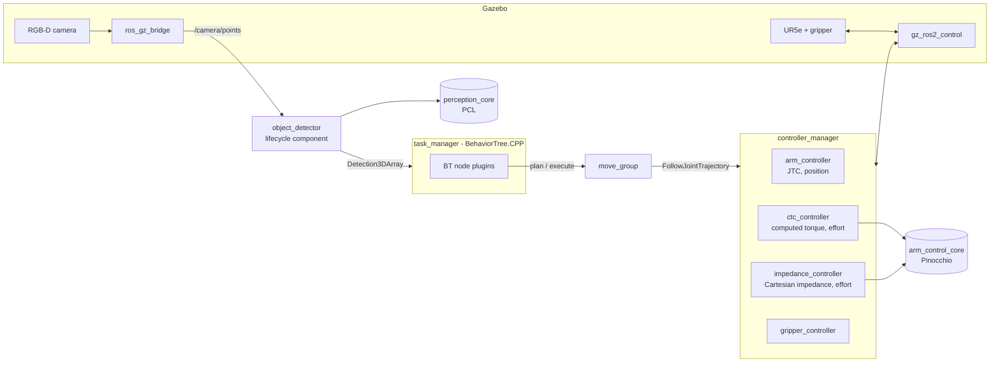
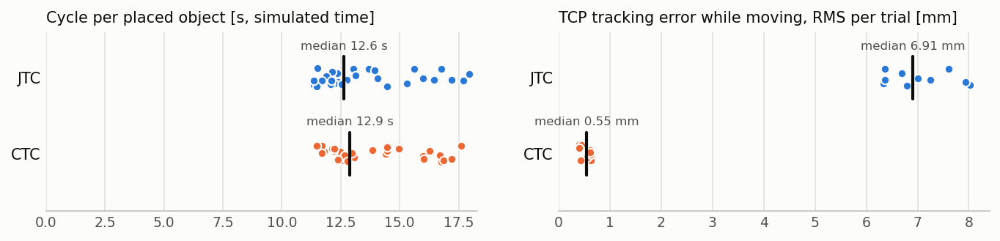

# vision_pick_place

[](https://github.com/ssebba/vision_pick_place/actions/workflows/ci.yml)


[](LICENSE)

**Vision-guided pick and place with a UR5e in Gazebo: PCL perception, MoveIt 2 planning,
BehaviorTree.CPP orchestration and two model-based ros2_control controllers written from
scratch (computed torque and Cartesian impedance, on Pinocchio).**

<p align="center">
  
</p>
<p align="center"><i>One complete task at 3x speed (computed-torque controller, seed 1): the RGB-D
camera above the table finds the three objects, MoveIt plans every motion and the behavior tree
places them in a row.</i></p>

**Results in Gazebo** (20 trials: 10 random scenes x 2 arm controllers, details in
[Results](#results)):

- **60/60 objects picked and placed**, each checked against the simulator's ground truth:
  detection error 0.8 mm on average (2.0 mm at most), every box and cylinder classified
  correctly, placement within 2 mm;
- **the computed-torque controller follows MoveIt's trajectories 13x more closely** than the
  stock joint trajectory controller driving Gazebo's position interface: 0.53 mm vs 7.0 mm RMS
  at the tool while moving, at the same cycle time;
- **Cartesian impedance with the stiffness it is given**: 600 N/m commanded, 600 N/m measured
  along x, y and z.

## Contents

- [Highlights](#highlights)
- [Quickstart](#quickstart)
- [Architecture](#architecture)
- [How it works](#how-it-works)
- [Results](#results)
- [Design decisions](#design-decisions)
- [Testing and quality](#testing-and-quality)
- [Limitations and roadmap](#limitations-and-roadmap)

## Highlights

- **Model-based control from first principles**: a computed-torque trajectory controller that
  MoveIt executes through the standard `FollowJointTrajectory` action, and a Cartesian impedance
  controller with gravity/Coriolis compensation and task-space-inertia damping, both real-time
  safe ros2_control plugins built on a ROS-agnostic dynamics library (Pinocchio).
- **Perception without deep learning**: table segmentation (RANSAC), Euclidean clustering,
  footprints from the top face of each object, robust to the stray points of depth images
  (minimum-area rectangles, defined also for square objects where PCA is not), box/cylinder
  classification, then top-down grasps across the narrow side.
- **Task logic as a behavior tree**: BehaviorTree.CPP nodes compiled as a plugin, retries and
  recovery expressed in XML, MoveIt for collision-free and straight-line motions.
- **Measured, not claimed**: every trial checks detection accuracy, grasp and placement
  against the simulator ground truth.
- **Modern ROS 2 engineering**: lifecycle components, parameters declared and validated with
  `generate_parameter_library`, pluginlib everywhere (controllers, BT nodes), unit tests on the
  pure libraries, CI with `-Werror`, clang-tidy and clang-format, Docker and devcontainer.

## Quickstart

```bash
git clone https://github.com/ssebba/vision_pick_place.git && cd vision_pick_place
docker compose up demo
```

Native (ROS 2 Lyrical):

```bash
mkdir -p ~/ros_ws/src && cd ~/ros_ws/src && git clone https://github.com/ssebba/vision_pick_place.git
cd ~/ros_ws && rosdep install --from-paths src --ignore-src -y
colcon build --cmake-args -DCMAKE_BUILD_TYPE=Release && source install/setup.bash
ros2 launch pp_bringup pick_place.launch.py                                 # stock JTC
ros2 launch pp_bringup pick_place.launch.py arm_controller:=ctc_controller  # computed torque
```

Benchmark and measurements (headless):

```bash
ros2 run pp_bringup run_trials.sh ~/pick_place_results       # 10 scenes x {JTC, CTC}
python3 src/vision_pick_place/tools/analyze_trials.py ~/pick_place_results --out results
src/vision_pick_place/tools/measure_stiffness.sh 10.0          # impedance controller stiffness
```

or `docker compose run --rm benchmark` (results in `./results`). The scripts start their own
headless simulations and stop every ROS process when they end: run them on an idle machine.

## Architecture



| Package | Kind | Contents |
|---|---|---|
| [`arm_control_core`](arm_control_core) | pure C++ (Eigen, Pinocchio) | rigid-body model (pimpl), trajectory interpolation, computed-torque / PD+gravity / Cartesian impedance laws |
| [`arm_controllers`](arm_controllers) | ros2_control plugins | `ComputedTorqueController` (FollowJointTrajectory, effort), `CartesianImpedanceController` |
| [`perception_core`](perception_core) | pure C++ (PCL) | tabletop segmentation, clustering, oriented boxes, shape classification, grasp planning |
| [`pp_perception`](pp_perception) | lifecycle component | point cloud to `vision_msgs/Detection3DArray` and RViz markers |
| [`pp_task`](pp_task) | BT plugins + lifecycle component | MoveIt-based BT nodes, `TaskManager`, benchmark records |
| [`pp_description`](pp_description) | xacro | UR5e on a table, parallel gripper, RGB-D camera, ros2_control and Gazebo plugins |
| [`pp_moveit_config`](pp_moveit_config) | MoveIt config | SRDF, kinematics, limits, controllers, `move_group` launch |
| [`pp_bringup`](pp_bringup) | launch | simulation with random objects, full demo, trial script |

## How it works

**Perception** ([`object_detector.hpp`](perception_core/include/perception_core/object_detector.hpp)).
The RGB-D cloud is transformed to the world frame, cropped to the workspace and voxelized
(4 mm). RANSAC finds the table plane (constrained perpendicular to z), the points above it
are clustered (Euclidean, 1.5 cm) and each cluster becomes an oriented box. Depth images have
stray points around the silhouettes (depth interpolated across the edge), so the height is the
median of the points near a high quantile, and the footprint comes from the top face without
the points that lie more than 3 mm outside its central part (the smallest rectangle leaving out
2 % of the points beyond each side): the minimum-area rectangle of the rest (convex hull +
rotating calipers) gives position, orientation and size. A cylinder fills about pi/4 of that
rectangle, a box all of it: the fill ratio classifies the shape.

**Grasp planning** ([`grasp_planner.hpp`](perception_core/include/perception_core/grasp_planner.hpp)).
Top-down grasps across the narrow side of the box (four directions for a cylinder), the
fingers reaching 60% of the object height (at most their length), the wrist rotation closest
to the preferred one among the symmetric candidates, the pre-grasp 12 cm above. Objects that
do not fit in the open gripper with 1 cm of clearance per side are rejected.

**Task** ([`pick_place.xml`](pp_task/behavior_trees/pick_place.xml)). A BehaviorTree.CPP tree,
its nodes compiled as a plugin library: observe, detect, select the closest object not
already failed, plan the grasp, approach with a collision-free motion, descend and lift with
straight Cartesian motions, close the gripper, verify the lift, place on the next free slot
and verify the placement. A failed pick is recovered (gripper opened, object marked) and the
loop moves on to the next object.

**Computed-torque control** ([`computed_torque_controller.hpp`](arm_controllers/include/arm_controllers/computed_torque_controller.hpp)).
A ros2_control controller with effort command interfaces and the standard
`FollowJointTrajectory` action, so MoveIt drives it exactly like the stock trajectory
controller. Each cycle (500 Hz) it samples the trajectory (quintic interpolation when
accelerations are given, as in MoveIt's trajectories) and applies

$$\tau = M(q)\,(\ddot q_d + K_d \dot e + K_p e) + C(q,\dot q)\,\dot q + g(q)$$

with the inverse dynamics computed by Pinocchio's RNEA: the closed loop becomes a set of
decoupled second-order systems with the chosen bandwidth. The `pd_gravity` mode
($\tau = K_p e + K_d \dot e + g(q)$, gains scaled by the joint inertia) is the classic
baseline it is compared against.

**Cartesian impedance** ([`cartesian_impedance_controller.hpp`](arm_controllers/include/arm_controllers/cartesian_impedance_controller.hpp)).
$\tau = J^\top (K\,e - D\,\dot x) + C\dot q + g + \tau_{null}$, with the damping of each
direction computed from the task-space inertia $\Lambda = (J M^{-1} J^\top)^{-1}$ for a chosen
damping ratio, a saturated spring for distant targets and a null-space posture task. The
target pose arrives on a topic and the measured pose is published for monitoring.

## Results

Ten random scenes (`seed` 1-10, three objects each: boxes and cylinders 4-6 cm wide at random
positions and orientations), each solved once with the stock joint trajectory controller (JTC,
position interface) and once with the computed-torque controller (CTC, effort interface): 20
trials, every one in a fresh headless simulation
([`run_trials.sh`](pp_bringup/scripts/run_trials.sh)), analysed by
[`analyze_trials.py`](tools/analyze_trials.py). Grasp, placement and detection are checked
against the simulator's ground truth; times are simulated time, except planning (wall clock).
Per-object and per-trial data: [`docs/results`](docs/results).

### Task

| Arm controller | Trials finished | Grasped | Placed | Trials with every object placed | Placement error [mm] | Cycle per object [s] | Planning per object [s] |
|---|---|---|---|---|---|---|---|
| Joint trajectory (stock, position) | 10/10 | 30/30 | 30/30 | 10/10 | 0.7 (max 1.8) | 13.6 ± 2.1 | 0.24 |
| Computed torque (ours, effort) | 10/10 | 30/30 | 30/30 | 10/10 | 0.8 (max 1.6) | 13.8 ± 2.0 | 0.25 |

### Perception

| Shape | Objects | Classified correctly | Placed | Detection error [mm] |
|---|---|---|---|---|
| box | 40 | 40/40 | 40/40 | 0.7 (max 1.5) |
| cylinder | 20 | 20/20 | 20/20 | 1.0 (max 2.0) |

### Tracking (while the reference moves)

| Arm controller | Trials | Joint error RMS [mrad] | TCP error RMS [mm] | TCP error 99th percentile [mm] | TCP error at rest [mm] |
|---|---|---|---|---|---|
| Joint trajectory (stock, position) | 10 | 7.59 | 7.04 | 17.14 | 0.000 |
| Computed torque (ours, effort) | 10 | 1.02 | 0.53 | 1.62 | 0.016 |

<p align="center">
  <picture>
    <source media="(prefers-color-scheme: dark)" srcset="docs/results/trials_dark.png">
    
  </picture>
</p>

**Tracking.** Both controllers execute the same MoveIt trajectories, so the cycle time is the
same; what differs is how closely the arm follows them. The stock JTC writes positions to
gz_ros2_control's position interface, which reaches them through an internal velocity loop: the
tool lags behind the plan by 7.0 mm RMS while moving (17 mm at the 99th percentile). The CTC
computes the joint torques from the model (Pinocchio's RNEA, with the trajectory's accelerations
as feed-forward) and keeps the tool within 0.53 mm RMS (1.6 mm at the 99th percentile); at rest
it holds the pose within 0.02 mm. The caveat matters: on a real UR the JTC would command the
robot's own servo loop, much stiffer than Gazebo's position interface. What the comparison
shows is that the torque-level controller tracks well beyond what this simulation offers through
positions, and that its dynamic model matches the simulated arm: model errors, the limit of any
computed-torque controller, are the next thing to test (see the limitations).

**Impedance controller.** [`measure_stiffness.sh`](tools/measure_stiffness.sh) pushes the wrist
with 10 N along x, y and z through Gazebo and reads the controller's TCP: 16.7 mm every time,
600 N/m as commanded. With an exact model this verifies the control law and its gravity
compensation, not the robustness to model errors.

### What the trials caught

Every unit test passed before the first campaign; running the whole task over and over in a
fresh simulation found six problems, each traced to its cause and fixed:

1. **Gazebo outliving its launch.** `ros_gz_sim` starts Gazebo through a shell that does not
   forward SIGINT: when a trial ended, the server kept running and every following trial
   found "another world of the same name". Gazebo is now started directly.
2. **Plans through the forearm.** With the UR5e's ±360° joint ranges, OMPL's random goals often
   needed a whole wrist turn: in a probe from the observation pose, 15-20 % of the plans to the
   pre-grasp and pre-place poses timed out or crossed the gripper through the forearm between
   two collision checks. Joint limits sized to the cell (one turn per joint, upper arm above
   the table) and denser collision checks: 120 plans out of 120 in the same probe.
3. **A goal that never ended.** When the arm is already at the goal, MoveIt sends a single
   point at t = 0; the computed-torque controller accepted it and never answered, and the task
   waited until the trial timed out. Fixed in the controller (unit test added), and the task
   now cancels any motion whose result does not come in time.
4. **Ctrl+C stuck in MoveIt.** `MoveGroupInterface::execute` waits for the result without a
   timeout: the task now sends the `ExecuteTrajectory` goal itself and cancels it when stopped,
   so the launch exits in under a second instead of being killed after 15 s.
5. **Stray depth points.** Around the silhouettes the simulated depth camera returns points
   interpolated across the edge: the convex hull of a cluster grew by up to 13 mm, the height
   by 6 mm, and a cylinder was once classified as a box. The footprint now comes from the top
   face without them (unit test with synthetic strays).
6. **A clock delivered in bursts.** The controller manager runs its controllers on the ROS
   clock; with `/clock` on the bridge that also converts the point clouds, 2.2-2.6 % of the
   control cycles repeated the previous time stamp. A dedicated bridge brings it to 1.0-1.3 %;
   what is left appears as rare spikes in the tracking error, which is why the tables report
   the 99th percentile rather than the maximum.

## Design decisions

1. **Model-based controllers as ros2_control plugins, not as nodes.** They run in the
   controller manager's real-time loop, claim the effort interfaces like any other controller
   and are switched with the standard tools. The real-time path has no allocation, no locks
   and no logging: goals reach it through `RealtimeThreadSafeBox`, state is published with
   `RealtimePublisher`, and a goal that arrives while the loop is reading keeps the previous
   one for a cycle instead of blocking.
2. **The dynamics stay out of ROS.** `arm_control_core` (Pinocchio + Eigen) knows nothing about
   ROS: the model is checked against itself (inverse vs forward dynamics, Jacobian vs finite
   differences) and the control laws are simulated in closed loop in milliseconds (computed
   torque tracks a sinusoid and beats PD+gravity, the impedance compliance matches the
   stiffness, the saturated spring bounds the force).
3. **`FollowJointTrajectory` on the computed-torque controller**, so MoveIt plans and executes
   through it unchanged and the comparison with the stock JTC is apples to apples: same
   planner, same trajectories, only the low-level control law changes.
4. **Damping from the task-space inertia.** A constant Cartesian damping is either too low for
   the heavy directions or unstable for the light ones at 500 Hz; $D = 2\zeta\sqrt{K\Lambda}$
   gives the same damping ratio in every direction and configuration.
5. **Geometry before learning.** On a known table with simple objects, plane segmentation and
   clustering are exact, fast (a few ms) and need no dataset; the minimum-area rectangle is
   used instead of PCA because PCA is undefined for square footprints, and it is computed on
   the top face without the stray points of the depth image, which made the convex hull up to
   13 mm wider in simulation.
6. **Simulated grasps are attached, and the benchmark says so.** Friction-only grasps in
   Gazebo slip unpredictably; after the fingers close, the task attaches the object to the
   wrist (`DetachableJoint`) and detaches it on release. Lift and placement are still
   verified against the simulator's ground truth, never assumed.
7. **Behavior tree for the task logic.** Retries and recovery are visible in the XML instead of
   being buried in a state machine; the nodes are a plugin library loaded by the
   `TaskManager` lifecycle component, and a unit test checks that the plugin registers every
   node the tree uses. Motions go through move_group's `ExecuteTrajectory` action with a wait
   that gives up (and cancels the motion) when the task is stopped:
   `MoveGroupInterface::execute` waits without a timeout, so a Ctrl+C mid-motion used to leave
   the task thread blocked until the process was killed.
8. **Reproducible trials.** The world is generated from a seed (shapes, poses), every trial
   starts a fresh simulation, and every pick is logged with its timing and its error against
   the ground truth.

## Testing and quality

| Suite | Type | What it covers |
|---|---|---|
| `arm_control_core` (18 tests) | GoogleTest, no ROS | UR5e model loading, mass matrix symmetric positive definite, inverse vs forward dynamics, Jacobian vs finite differences, payload scaling, quintic/cubic/linear interpolation, closed-loop computed torque vs PD+gravity, impedance compliance and saturation |
| `arm_controllers` (8 tests) | GoogleTest: controller lifecycle driven as the controller manager does, hardware interfaces of an arm simulated with the forward dynamics | interface claiming, gravity compensation at rest, a `FollowJointTrajectory` goal sent through the action server and executed to within 0.01 rad, goals without duration answered at once, goal validation, mode switching, impedance spring torque |
| `perception_core` (17 tests) | GoogleTest on synthetic clouds | table segmentation, oriented box of rotated and square objects, box/cylinder classification, stray depth points around the objects, several objects, workspace crop, trimmed and minimum-area rectangles, grasp orientation, width and reachability ordering |
| `pp_perception` (1 test + 1 `launch_testing`) | in-process node and launched executable | TF handling and detections in the world frame; lifecycle autostart, parameters and topics of the installed executable with a box and a cylinder |
| `pp_task` (7 tests) | GoogleTest | behavior tree plugin and XML loading, detection conversions, target selection, result records, ground-truth model matching |

```bash
colcon test --packages-up-to pp_bringup && colcon test-result --verbose
```

Quality gates in CI (GitHub Actions, `ros:lyrical` image): build with `-Werror`, all the tests
above, `clang-tidy` on all the sources, `clang-format` check and the Docker image build.

## Limitations and roadmap

- **Simulated grasps.** Objects are attached to the wrist once the fingers close (see the design
  decisions): grasp success here measures perception, grasp planning and motion accuracy, not
  contact physics.
- **Scene assumptions.** One known horizontal table, isolated boxes and cylinders, top-down
  grasps only: no clutter, stacking or unknown shapes.
- **Model-based control needs the model.** The computed-torque controller has no integral
  action: an unmodeled load shows up as a steady-state error (0.24 kg left on the wrist by a
  lost release command produced 0.04 rad on a wrist joint before the fix). Payload
  identification (`RobotModel::scalePayload` is the hook) is the natural next step.
- **The impedance controller is characterized, not yet used by the task.** Its stiffness is
  measured in simulation; compliant insertion or placement on contact would use it.
- **Conservative motions.** MoveIt velocity scaling 0.4 and slow straight approaches keep the
  cycle around 14 s per object.
- **Simulation only.** Not tested on a physical arm or camera.

Roadmap: grasp planning on point clouds of unknown objects, payload identification after the
grasp, compliant placement with the impedance controller, Gazebo grasping with friction and
finger force control.

## License

[Apache-2.0](LICENSE).
